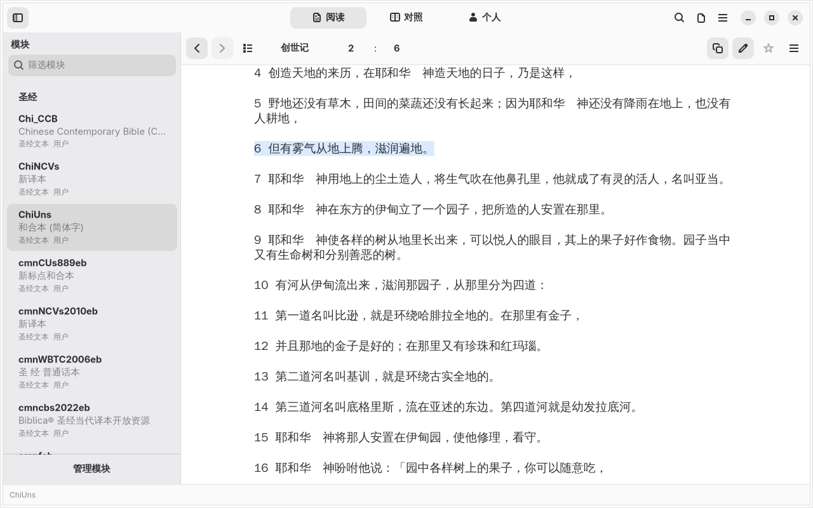
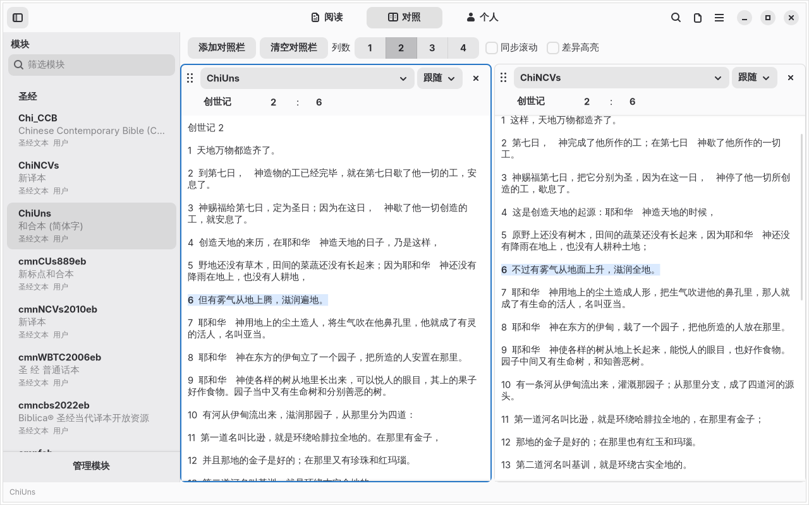
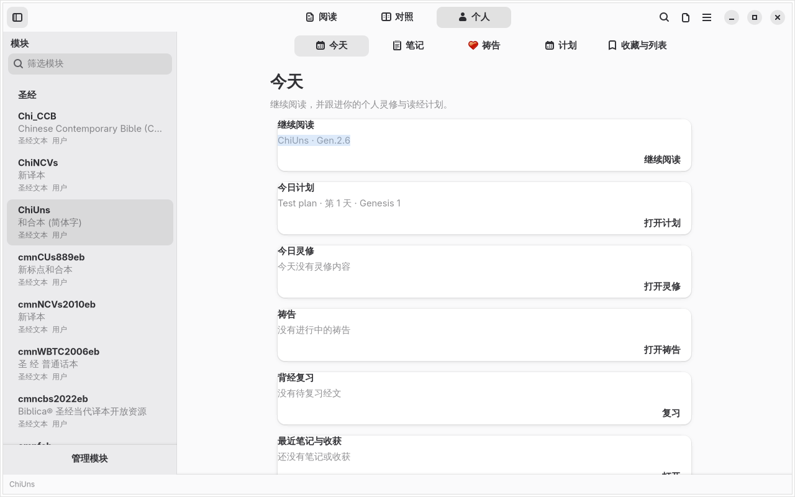
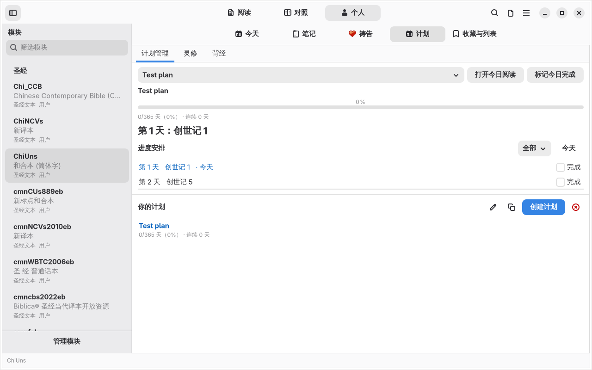
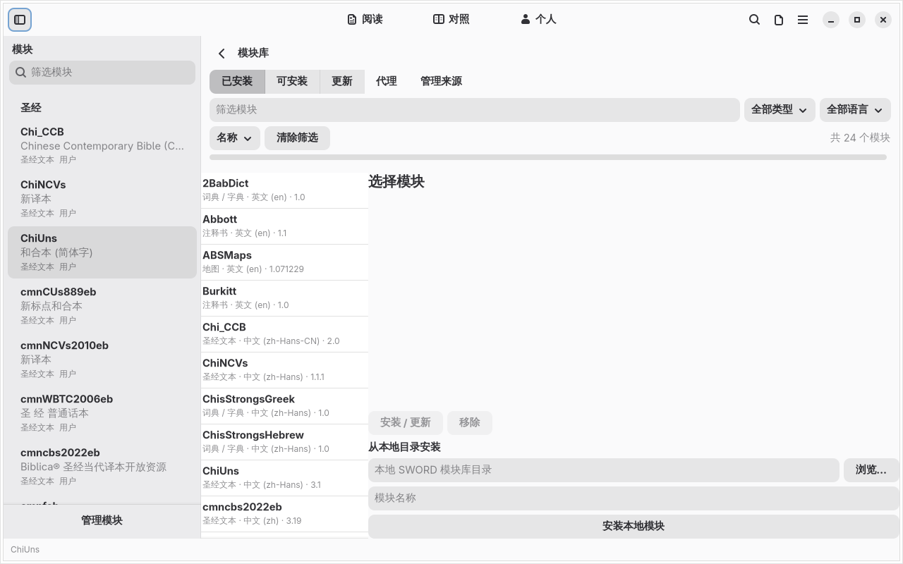
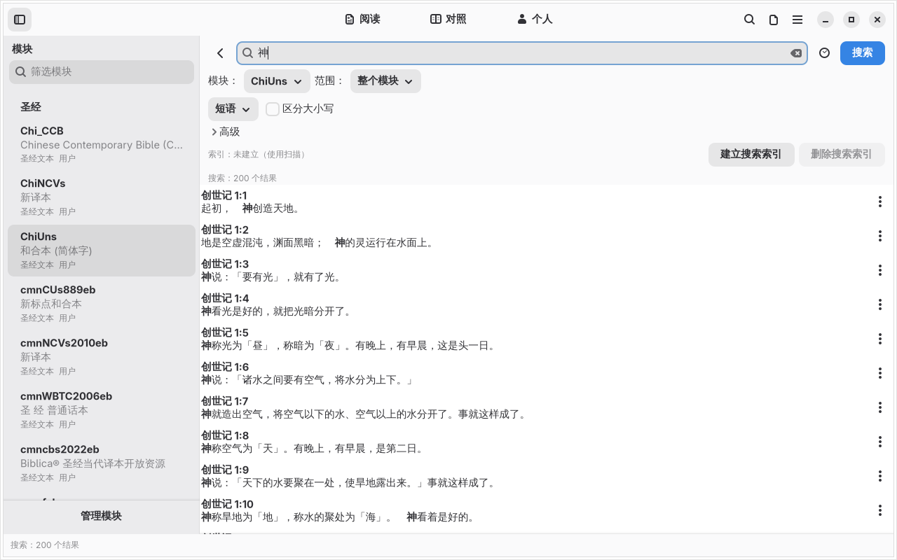
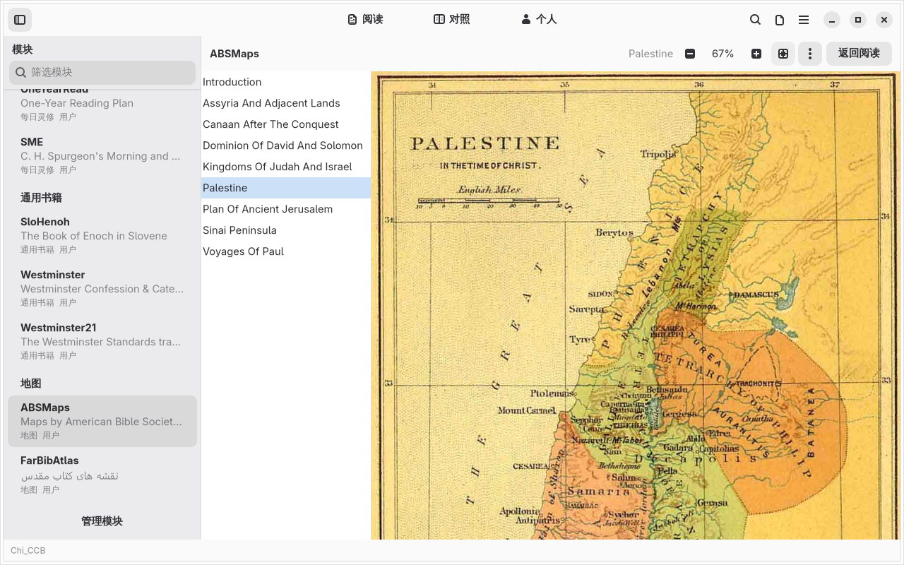
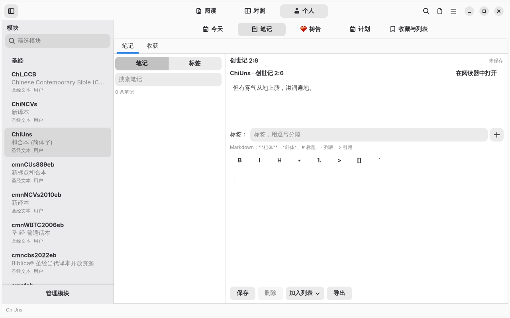

# GSword

**English** | [简体中文](README.zh_CN.md)

[](https://github.com/yetist/gsword/actions/workflows/ci.yml)

<p align="center">
  
</p>

**GSword is a modern Bible study application built with GTK4 / libadwaita.**

Its interface is organized around Scripture reading, parallel translation comparison, commentary and original-language study, personal notes, and reading plans. It reads SWORD modules directly.

At its core is **libgsword**: a from-scratch C / GObject reimplementation of the SWORD module library. It does not link against the upstream C++ `libsword`, and it provides GObject Introspection and a Vala API so other GTK/GNOME applications can reuse it.

- Source repository: <https://github.com/yetist/gsword>
- Issue tracker: <https://github.com/yetist/gsword/issues>

> The project is still under active development.

## Screenshots

| Reading | Compare |
| --- | --- |
|  |  |

| Personal center | Reading plans |
| --- | --- |
|  |  |

| Module library | Search |
| --- | --- |
|  |  |

| Maps | Notes |
| --- | --- |
|  |  |

## Features

### Reading

- Whole-chapter reading, book/chapter/verse selector, and reference input
- 1–4 column parallel translation comparison with synchronized scrolling, pinned panes, independent panes, and drag reordering
- Reading history back/forward, recent reading list, and reading position restoration
- Focus reading mode, reading width, font size, line spacing, and serif/sans-serif body text
- Preserve the current passage when switching translations; fall back to the first chapter of the same book if the new module lacks the verse
- Localized book names and abbreviations with “follow module language” or “follow interface language” modes

### Study

- Commentary, lexicon, dictionary, Strong's, cross-reference, and original-language resources working together
- The study panel automatically refreshes commentary, lexicon, and original-language information for the selected verse
- Render options for footnotes, headings, red letter, Strong's, morphology tags, and more
- Verse selection, copy, share, and highlighting
- Map image viewer with fit width/window, zoom, pan, copy, and save-as support

### Personal content

- Personal center: Today, Notes, Prayer, Plans, Collections & Lists
- Today aggregates continue reading, today's plan, prayer summary, memory review, and recent notes
- Per-verse notes, tags, and verse highlights
- Verse lists and starred favorites: list management, one-click starring in the reader, and non-deletable system favorites
- Bookmarks with reading position, title, and notes, separate from reading history
- Insights: free-form text, optional verse association, tags, search, and updated-time sorting
- Prayer management: active/answered/archived items, search, filters, linked verses, and a prayer log
- Markdown editing, syntax highlighting, and export
- Reading plans, progress tracking, schedule filtering, memory review, and teaching layout
- Notes, prayer, plans, memory queues, and teaching handouts are stored in a local SQLite database

### Search

- Phrase, multiword, regex, and attribute search
- Scope by module, Old/New Testament, current book, or current chapter
- Asynchronous search with progress, cancellation, and result counts
- Search result context menu: copy, open, add note, add to memory/verse list, and view module information
- Optional persistent inverted index stored in the XDG cache directory

### Module management

- Read common SWORD modules including RawText, zText, RawCom, zCom, RawLD, zLD, RawGenBook, RawFiles, and HREFCom
- Installed, available, and updates views
- Install and update modules from HTTP/HTTPS/FTP sources with progress, cancellation, proxy support, and retry
- Local directory installation, encrypted module unlocking, and dependency/conflict prompts
- Writable user module library, read-only system library overlay, and user library priority

## libgsword

`libgsword` is the underlying module library and an important part of the project, while the product focus is the desktop Bible study experience.

It provides:

- `GswManager`, `GswModule`, and `GswModuleInfo`
- `GswVerseKey`, `GswStrKey`, and `GswTreeKey`
- `GswInstallManager`, `GswInstallSource`, and `GswStatusReporter`
- `GswLocaleMgr` and localized book names
- GObject Introspection, GIR/typelib, Vala API, and gi-docgen documentation

Design goals:

- Do not link against upstream C++ `libsword`; reimplement the public behavior, directory layout, and storage formats of SWORD 1.9
- Read common SWORD modules and support installing, updating, deleting, and writing them
- Use GObject-style core APIs for GTK, GNOME, and other language bindings

See [`docs/design.md`](docs/design.md) for the detailed library design.

## Project layout

```text
libsword/
├── src/                  GSword GTK4 application and reference chooser
├── lib/                  libgsword implementation
├── include/gsword/       libgsword public API
├── data/locales.d/       libgsword locale data
├── tools/                Locale import, validation, and versification tools
├── examples/             Library examples and GTK4 prototype
├── tests/                Library tests, reference chooser tests, and demos
├── docs/                 Design, format, milestone, and application docs
└── sword-1.9.0/          Upstream SWORD sources, reference only, not built
```

The GSword application depends only on the public interfaces in `include/gsword/`.

## Building

```sh
git clone https://github.com/yetist/gsword.git
cd gsword

meson setup build
meson compile -C build
```

When building only the library and tests without the desktop application, GTK4/libadwaita/SQLite3 may be absent. The desktop application requires:

- GTK4
- libadwaita
- SQLite3
- Optional GtkSourceView 5

## Running GSword

```sh
./build/src/gsword
```

By default, GSword uses the XDG user module library. You can also specify it explicitly:

```sh
./build/src/gsword --library ~/.sword
# or
GSWORD_LIBRARY=~/.sword ./build/src/gsword
```

To use the interface translations from a development build:

```sh
LANG=zh_CN.UTF-8 GSW_LOCALEDIR=$PWD/build/po \
  ./build/src/gsword --library ~/.local/share/gsword/library
```

## User data directories

GSword uses XDG directories and separates the module library, configuration, and cache:

```text
~/.local/share/gsword/library/   Writable SWORD module library
~/.local/share/gsword/app.db     SQLite: notes, plans, memory, teaching handouts
~/.local/share/gsword/exports/   Default export directory
~/.config/gsword/installmgr/     InstallMgr.conf
~/.cache/gsword/installmgr/      Download cache and remote module lists
~/.cache/gsword/search/          Search indexes
```

The system module library (for example `/usr/share/sword`) is overlaid read-only, with the user library taking priority.
`~/.sword` is no longer used implicitly; to use an old library, switch it in Preferences or pass
`--library PATH` / `GSWORD_LIBRARY=PATH`.

## Testing and development

```sh
meson test -C build

# ASan build
meson setup build-asan -Db_sanitize=address
meson test -C build-asan
```

Library examples:

```sh
# List local modules
./build/examples/gsword-list-modules ~/.local/share/gsword/library

# Read verses
./build/examples/gsword-lookup ~/.local/share/gsword/library KJV "John 3:16"
./build/examples/gsword-lookup ~/.local/share/gsword/library KJV "启示录 1:1" zh-Hans

# Module info, chapters, dictionaries, and general books
./build/examples/gsword-module-info ~/.local/share/gsword/library KJV
./build/examples/gsword-chapter ~/.local/share/gsword/library KJV "John 3"
./build/examples/gsword-dict-lookup ~/.local/share/gsword/library StrongsGreek G26
./build/examples/gsword-genbook-walk ~/.local/share/gsword/library BookChapter 1
./build/examples/gsword-render-options ~/.local/share/gsword/library KJV "John 3:16" "Strong's Numbers=On"
./build/examples/gsword-html ~/.local/share/gsword/library KJV "John 3:16" verse > verse.html
./build/examples/gsword-html ~/.local/share/gsword/library KJV "John 3" chapter > chapter.html
./build/examples/gsword-html ~/.local/share/gsword/library KJV "John" book > john.html
./build/examples/gsword-locale ~/.local/share/gsword/library zh-Hans KJV "来 4:1"
./build/examples/gsword-search ~/.local/share/gsword/library KJV "God so loved" phrase
./build/examples/gsword-search ~/.local/share/gsword/library KJV "God.*world" regex
./build/examples/gsword-index-module ~/.local/share/gsword/library KJV build
./build/examples/gsword-index-module ~/.local/share/gsword/library KJV status
./build/examples/gsword-parallel ~/.local/share/gsword/library KJV "John 3:16" "Rom 8:1"
```

Install modules:

```sh
./build/examples/gsword-install-sources ~/.config/gsword/installmgr
./build/examples/gsword-install-module \
  ~/.local/share/gsword/library ~/.config/gsword/installmgr CrossWire KJV
./build/examples/gsword-async-install \
  ~/.local/share/gsword/library ~/.config/gsword/installmgr CrossWire KJV
```

## GObject Introspection and documentation

Generate GIR/typelib and the Vala API:

```sh
meson setup build-gir -Dintrospection=true
meson compile -C build-gir
meson test -C build-gir introspection
# GIR: build-gir/GSword-0.1.gir
# typelib: build-gir/GSword-0.1.typelib
# Vala: build-gir/gsword.vapi
```

The GIR namespace is `GSword`; the VAPI namespace is `Gsw`.

Generate API documentation:

```sh
meson setup build-doc -Ddocs=true
meson compile -C build-doc docs
# Output: build-doc/docs/reference/gsword/index.html
```

## Build options

- `-Dtests=true`: build and register tests (enabled by default)
- `-Ddocs=true`: enable gi-docgen API documentation and introspection
- `-Dintrospection=true`: generate GIR/typelib and the Vala API
- `-Dbzip2=auto` / `-Dlzma=auto`: auto-detect optional compression libraries
- The desktop application is built when GTK4, libadwaita, and SQLite3 are detected; the reference chooser demo is built when GTK4 is detected

## Documentation

- [`docs/design.md`](docs/design.md): libgsword architecture, object model, and API design
- [`docs/formats.md`](docs/formats.md): configuration files, module directories, Raw/z storage formats, and install sources
- [`docs/upstream-analysis.md`](docs/upstream-analysis.md): upstream SWORD 1.9 source analysis
- [`docs/app-design.md`](docs/app-design.md): GSword desktop application features and UI design

## Dependencies

- GLib / GObject / GIO (>= 2.66)
- libcurl (>= 7.68)
- zlib
- Optional: libbz2, liblzma, gobject-introspection, vala/vapigen, gi-docgen
- GSword desktop application: GTK4, libadwaita, SQLite3, optional GtkSourceView 5
- Meson / Ninja, pkg-config

## Contributing

Issues, suggestions, and improvements are welcome through GitHub Issues:

<https://github.com/yetist/gsword/issues>

## License

GPL-2.0-or-later, consistent with upstream SWORD and the old `gsword`. See
[`COPYING`](COPYING) for the complete license text.
